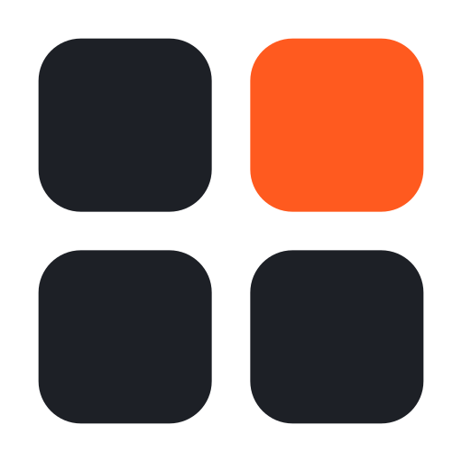

<p align="center">
  
</p>

<h1 align="center">lompii.</h1>

<p align="center">
  <strong>Your mind for what you find.</strong><br />
  A private visual library for everything that inspires you. Save from anywhere, find it by describing it.
</p>

<p align="center">
  <a href="https://github.com/Brosski224/lompii/releases/latest">Download for Windows</a>
  &nbsp;·&nbsp;
  <a href="#features">Features</a>
  &nbsp;·&nbsp;
  <a href="#getting-started">Getting started</a>
  &nbsp;·&nbsp;
  <a href="#privacy">Privacy</a>
</p>

---

You saved it months ago: a dark site with huge type, a poster in a particular orange, a line
someone wrote that stuck. You don't remember where it was, what it was called, or which folder
it went into. With lompii you don't need to. Type what you remember, *"grainy portrait, deep
shadow"*, and it comes back.

lompii is a desktop app for designers, illustrators, photographers, writers and anyone else who
collects references, with a companion Chrome extension for saving from the web.

- **Save from anywhere.** One right-click saves an image, a piece of text or a capture of the page.
- **Find it by description.** Local models match what things *look like* and what they *mean*,
  not just the words in their titles.
- **Private by design.** Your library and its search stay on your computer. No account, no cloud.
- **Free.** Bring your own AI key, or run a local model and keep everything offline.

## Features

### Capture

- **Chrome extension.** Right-click an image or selected text and choose *Add to lompii*. From
  the toolbar, capture the visible area, the full page, a selected area, or the view after a
  3-second delay for hover menus. `Alt+Shift+S` goes straight to area selection.
- **Drag and drop** image files onto the window, or **paste** one with `Ctrl+V`.
- Every save from the web keeps its source address and page title.
- Four kinds: **Images**, **Captures**, **Quotes** and **Snippets**. Text with a quoted span
  becomes a quote, set in Garamond italic, with its author split out.

### Understand

- AI gives each item a **title**, a short **summary**, **search tags** for subject, style, mood,
  colour and layout, and any **text it can read** in the image. It reuses your existing tags and
  folds near-duplicates together.
- **Generate prompt** writes a text-to-image prompt (Midjourney, DALL·E, Stable Diffusion) that
  would recreate an image.

### Find

- **Search by description.** *"mountain landscape"* finds images by how they look (CLIP), and
  *"an AI meeting assistant"* finds anything by what it's about (MiniLM). Both run on your computer.
- **Keyword search** across titles, tags, summaries, notes, text and the words inside images.
  Press `Enter` to keep a word as a chip; chips combine.
- **Same vibe** shows the items most like the one you're looking at, by look, meaning, tags and
  colour.
- **Filters** for each kind, a floating search bar once you scroll, and a back-to-top button.

### Organise

- **Stacks**: named, coloured collections you build by hand. Turn any search into a stack in one
  click.
- **Tags**: add your own beside the AI's, and rename, merge or delete them across the library.
- **Notes** on any item, and a **colour palette** you can copy as hex.
- **Select several** cards to stack, tag, archive or delete them together.

### Archive

- **Drag a card onto the logo** to put it away. It leaves Everything and Stacks but is kept, with
  its own search. Drag it onto the logo again from the archive to bring it back.
- **Optional 6-digit PIN.** Set one in Settings and the archive asks for it each time it opens.

### Keep it safe

- **Runs in the tray**, so the extension can always save. Optionally starts when you sign in, and
  can free its memory while in the tray.
- **Trash with undo.** Deleted items stay for 30 days and can be restored.
- **One-click backup** of the whole library to a folder you choose.
- **Light and dark mode**, and three card sizes.

## Getting started

### 1. Install the app

Download the **lompii Setup** installer (`.exe`) from the [latest release](https://github.com/Brosski224/lompii/releases/latest)
and run it. The installer isn't code-signed yet, so Windows SmartScreen may warn you the first
time: choose **More info → Run anyway**.

### 2. Connect your browser

The extension comes with the app and needs no build step.

1. In lompii, open **Settings → Extension** and click **Show folder**.
2. In Chrome, open `chrome://extensions`, turn on **Developer mode**, click **Load unpacked** and
   choose that folder.
3. On the page that opens, click **Connect**. lompii comes forward showing a four-digit code;
   if it matches the one in the browser, click **Allow**.

That's it. Right-click any image and choose **Add to lompii**.

| How | What it saves |
| --- | --- |
| Right-click an image → *Add to lompii* | the image, at the largest size the site offers |
| Select text, right-click → *Add to lompii* | a quote or a snippet |
| Right-click the page → *Capture an area…* | part of the page |
| Toolbar popup | the visible area, full page, a selected area, a delayed capture, or selected text |
| `Alt+Shift+S` | a selected area (`Enter` takes the whole view, `Esc` cancels) |

You can change the shortcut at `chrome://extensions/shortcuts`.

### 3. Add an AI provider (optional)

Search by description and Same vibe work without any key. AI adds titles, summaries and tags.
Open **Settings → AI providers** and choose one:

| Provider | You need | Default model |
| --- | --- | --- |
| Anthropic (Claude) | an API key | `claude-opus-5` |
| OpenAI | an API key | `gpt-4o-mini` |
| Google Gemini | an API key | `gemini-3.8-flash` |
| OpenRouter | an API key | `google/gemini-3.8-flash` |
| Ollama | Ollama running on your computer | any model you have |
| OpenAI-compatible server (LM Studio, LiteLLM, vLLM…) | its address, and a key if it asks | any model it serves |

Any model that reads images will do. You pay your provider directly for what you use, or nothing
with a local model. New saves are analysed automatically; *Analyse* on the main screen catches up
on older ones.

## Keyboard shortcuts

| Key | Action |
| --- | --- |
| `Ctrl+K` | Search |
| `Enter` in search | Keep the typed word as a chip |
| `Backspace` in an empty search | Remove the last chip, then the filter |
| Arrow keys | Move between cards |
| `Enter` | Open the selected card |
| `A` | Archive the selected cards (unarchive, in the archive) |
| `Delete` | Move the selected card to the trash |
| `Ctrl`-click / `Shift`-click | Select several cards / a run of cards |
| `Esc` | Close, clear or step back |
| `Ctrl+V` | Save a pasted image |

## Privacy

lompii has no account and no server. Everything lives in `%APPDATA%\lompii\` on your computer:

| Path | What's in it |
| --- | --- |
| `lompii.db` | the library: items, tags, stacks and search data (SQLite) |
| `library/`, `thumbs/` | your files and their thumbnails |
| `models/` | the search models, downloaded once on first run (about 170 MB) |
| `settings.json` | your preferences; AI keys are encrypted with Windows' secure storage |

- **Only one thing leaves your computer:** when an item is analysed, or you ask for a prompt, that
  item (a resized image or its text) is sent to the AI provider *you* chose. With Ollama or a
  local server, nothing leaves at all.
- The extension talks to the app over `127.0.0.1` only, with a key handed over when you approve
  the four-digit code. Web pages can't reach your library.
- The archive PIN is stored only as a salted hash, and five wrong guesses in a row slow further
  tries. It keeps the archive private inside lompii. It doesn't encrypt the files on disk.

## Build from source

You'll need **Node.js 22** or newer and **Windows**.

```bash
git clone https://github.com/Brosski224/lompii.git
cd lompii
npm install      # also builds the native modules for Electron
npm run dev      # runs the app, reloading as you edit
```

| Script | What it does |
| --- | --- |
| `npm run dev` | Run in development with hot reload |
| `npm run typecheck` | Type-check the project |
| `npm test` | Run the tests |
| `npm run build` | Type-check and build to `out/` |
| `npm run dist` | Build the Windows installer into `release/` |

After changing anything in `extension/`, click the reload icon on lompii's card in
`chrome://extensions`.

### How it fits together

```
Chrome extension ── HTTP, 127.0.0.1 ──┐
                                      ▼
┌──────────── Electron main process ────────────┐
│ server.ts  local API for the extension        │
│ ingest.ts  dedupe, thumbnail, colour, SQLite  │
│ ai.ts      analysis queue and providers       │
│ embed.ts   local CLIP and MiniLM search       │
│ index.ts   IPC, window, lompii:// files       │
└───────────────▲───────────────────┬───────────┘
          IPC (preload)        live updates
┌───────────────┴───────────────────▼───────────┐
│ Renderer: React + Tailwind                    │
└───────────────────────────────────────────────┘
```

| Folder | What's in it |
| --- | --- |
| `src/main/` | the Electron main process: database, saving, AI, search, the extension's API |
| `src/preload/` | the typed bridge between the main process and the window |
| `src/renderer/` | the React app |
| `src/shared/` | types and helpers both sides use |
| `extension/` | the Chrome extension (Manifest V3, plain JavaScript) |
| `test/` | tests for parsing, scoring and the PIN |

### Contributing

Issues and pull requests are welcome. A git hook runs the typecheck and tests before every push
(`npm install` turns it on), so fix what it reports rather than skipping it.

## Known limitations

- **Windows only for now.** macOS and Linux builds haven't been tested yet.
- **Full-page capture** stitches screenshots as it scrolls. Pages that scroll an inner panel come
  out as one screen, and very long pages stop at about 20,000 px.
- **One filter at a time** (a kind, a stack or same vibe), plus any number of search words.

## Roadmap

- Smart stacks that keep filling from a saved search
- Restoring a backup from inside the app
- macOS build and code signing

## Acknowledgements

- Provider logos from [Lobe Icons](https://github.com/lobehub/lobe-icons) (MIT).
- Search runs [CLIP](https://huggingface.co/Xenova/clip-vit-base-patch32) and
  [MiniLM](https://huggingface.co/Xenova/all-MiniLM-L6-v2) through
  [Transformers.js](https://github.com/huggingface/transformers.js).
