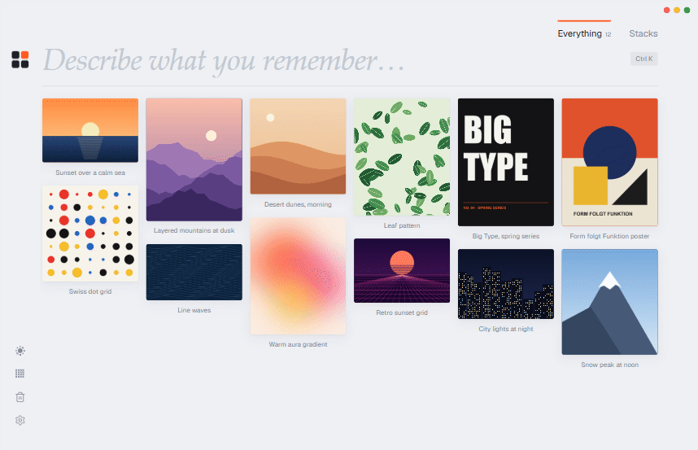
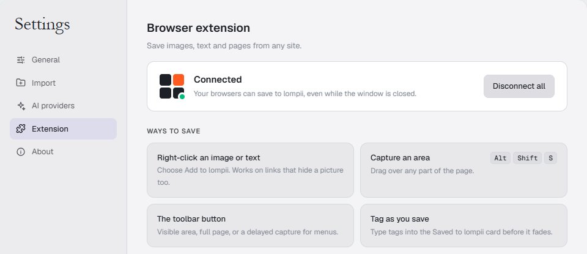
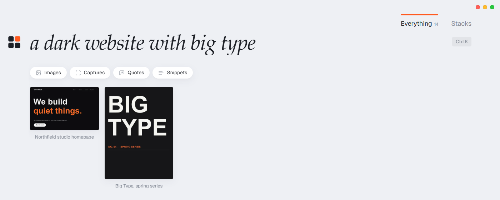
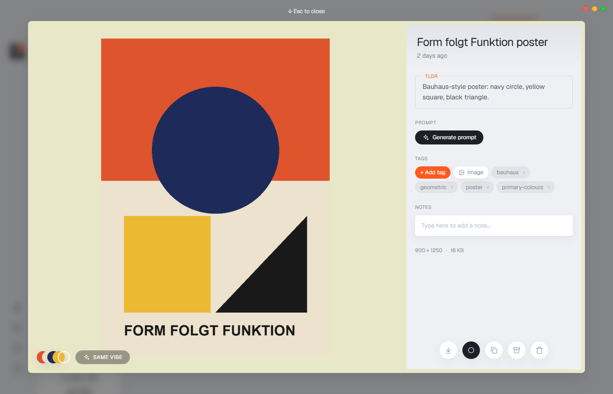
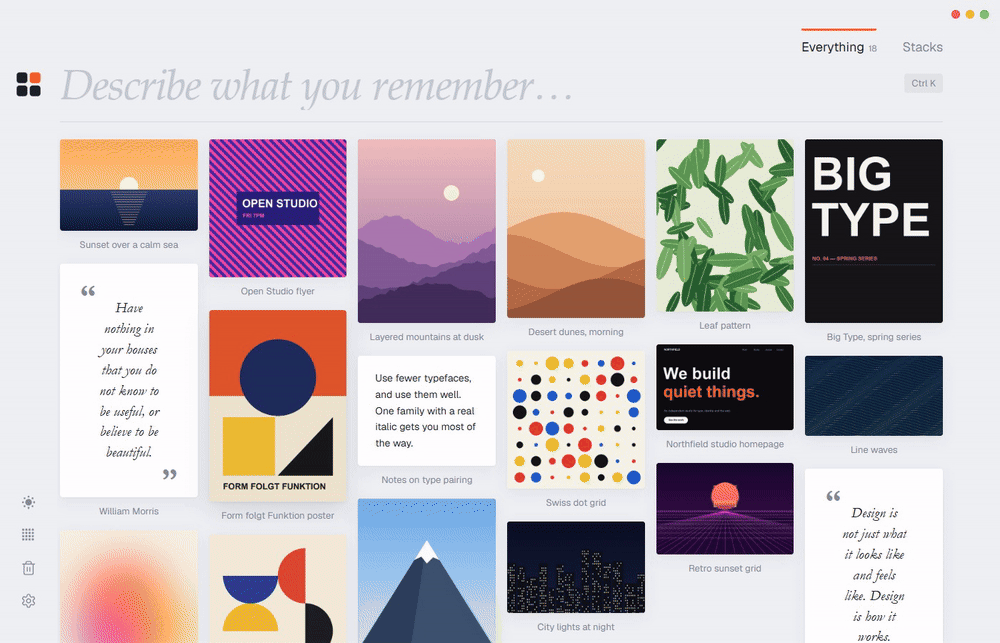
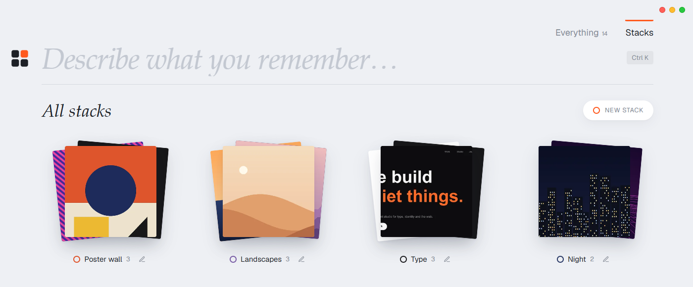
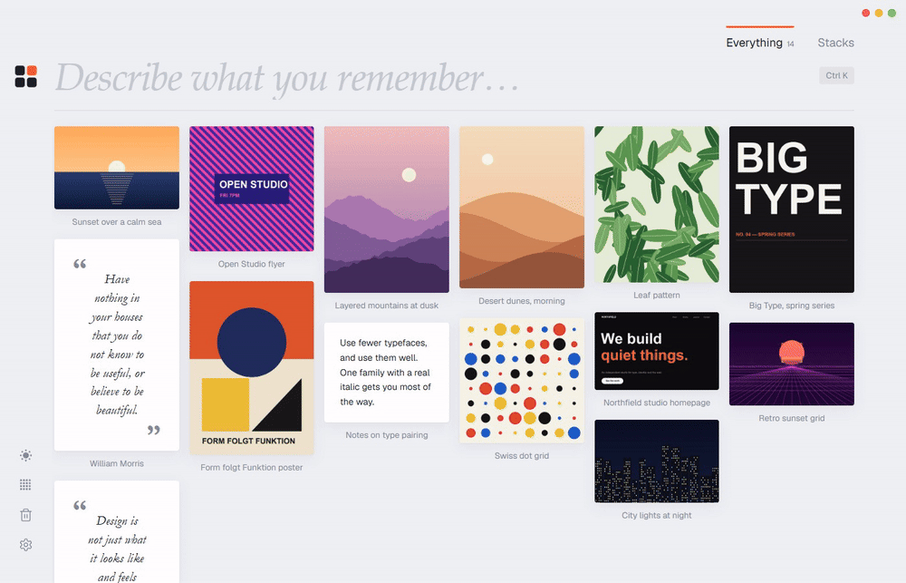
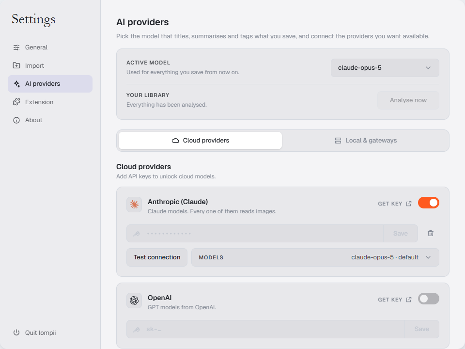

<p align="center">
  
</p>

<h1 align="center">lompii.</h1>

<p align="center">
  <strong>Your mind for what you find.</strong><br />
  Save inspiration from anywhere. Find it again by describing it.
</p>

<p align="center">
  <a href="https://github.com/lompii-app/lompii/releases/latest"></a>
  
  
  
  <a href="LICENSE"></a>
</p>

<p align="center">
  <a href="https://github.com/lompii-app/lompii/releases/latest"><strong>⬇ Download for Windows</strong></a>
  &nbsp;·&nbsp;
  <a href="#a-quick-tour">Tour</a>
  &nbsp;·&nbsp;
  <a href="#why-lompii">Why lompii</a>
  &nbsp;·&nbsp;
  <a href="#get-started-in-3-steps">Get started</a>
  &nbsp;·&nbsp;
  <a href="#questions">FAQ</a>
</p>

<p align="center">
  
  <br />
  <sub>Type what you remember, not what you named it. <a href="docs/images/demo.mp4">Watch in full quality</a>.</sub>
</p>

---

## What is lompii?

You saved it months ago: a dark website with huge type, a poster in a particular orange, a line
someone wrote that stuck. You don't remember where it was, what it was called, or which folder
it went into.

**lompii is a desktop app that remembers for you.** Save images, page captures, quotes and
snippets from your browser with one right-click. lompii looks at each one and works out what it
shows and what it's about. Later, type what you remember, *"grainy portrait, deep shadow"*, and it
comes back.

It's made for designers, illustrators, photographers, writers, and anyone who collects references.

<table>
  <tr>
    <td align="center" width="33%"><h3>1 · Save</h3>Right-click an image or text on any site, capture part of a page, or drop in a file.</td>
    <td align="center" width="33%"><h3>2 · lompii understands</h3>Each save gets a title, a summary, tags and its colours. You file nothing.</td>
    <td align="center" width="33%"><h3>3 · Find</h3>Describe it in your own words. lompii matches how things <em>look</em> and what they <em>mean</em>.</td>
  </tr>
</table>

## Why lompii?

Most places you keep inspiration are good at *storing* it and bad at *giving it back*.

|  | Folders on your computer | Browser bookmarks | Cloud inspiration apps | **lompii** |
| --- | :---: | :---: | :---: | :---: |
| Find something by describing it | ✗ | ✗ | some | **✓** |
| Find images by how they look, not just their words | ✗ | ✗ | some | **✓** |
| Keeps the image itself, even if the page disappears | ✓ | ✗ | ✓ | **✓** |
| Save from any website in one click | ✗ | ✓ | ✓ | **✓** |
| Your library stays on your computer | ✓ | ✓ | ✗ | **✓** |
| Works without an account | ✓ | ✓ | ✗ | **✓** |
| Free | ✓ | ✓ | usually paid | **✓** |
| Choose your own AI, or run one offline | n/a | n/a | rarely | **✓** |

What that means in practice:

- **Finding beats filing.** No folders to keep tidy. Search by look (*"mountain landscape"*), by
  meaning (*"an AI meeting assistant"*), or by the words written inside an image.
- **Private by design.** No account, no lompii server. Search runs on your own computer, and
  nothing leaves it except the item you send to the AI provider *you* chose. Choose a local model
  and nothing leaves at all.
- **Free, with any AI.** Bring a key from Anthropic, OpenAI, Google, OpenRouter, or run Ollama or
  LM Studio. Search by description works with no AI key at all.

## A quick tour

### Save from anywhere

The browser extension adds **Add to lompii** to the right-click menu on every site. Save an image
at the largest size the site offers, a quote or snippet of selected text, or a capture of the
visible area, the full page, or an area you drag over (`Alt+Shift+S`). Each save keeps the
address it came from. You can also drag image files onto the window, or paste one with `Ctrl+V`.

<p align="center">
  
</p>

### Find it by describing it

Type a few words about what you remember. lompii's local models compare your words with what each
image *looks like* (CLIP) and what each save *means* (MiniLM), alongside titles, tags, notes and
the text inside images. Press `Enter` to keep a word as a chip and narrow things down.

<p align="center">
  
</p>

### Every save, explained

Open any card to see it large, with its colour palette (click a swatch to copy the hex), a short
AI summary, tags, the source link and your notes. **Generate prompt** writes a text-to-image
prompt (Midjourney, DALL·E, Stable Diffusion) that would recreate the image.

<p align="center">
  
</p>

### Same vibe

Found one thing you like? **Same vibe** lines up everything in your library that's closest to it,
by look, meaning, tags and colour.

<p align="center">
  
</p>

### Stacks

Stacks are collections you build by hand: a poster wall, a moodboard for a client, a set of type
references. Give each one a colour, add cards from anywhere, or turn any search into a stack in
one click.

<p align="center">
  
</p>

### The archive, for things you want to keep but not see

> **Where is it?** Click the **lompii logo** at the top left. That's the archive's door.

- **To archive a card:** drag it onto the logo, or select it and press `A`, or click the archive
  button in its detail view. It leaves Everything and Stacks but is kept, with its own search.
- **To bring it back:** open the archive and drag the card onto the logo again (or press `A`).
- **To lock it:** set a 6-digit PIN in **Settings → General**. The archive asks for it each time
  it opens.

<p align="center">
  
</p>

### Light and dark

<p align="center">
  <picture>
    <source media="(prefers-color-scheme: dark)" srcset="docs/images/grid-dark.png" />
    
  </picture>
  <br />
  <sub>The grid in light or dark mode (this image follows your GitHub theme). Three card sizes.</sub>
</p>

### And the small things

- **Trash with undo.** Deleted items stay for 30 days and can be restored.
- **Select several** cards (`Ctrl`/`Shift`-click) to stack, tag, archive or delete them together.
- **Tags** of your own beside the AI's, and rename, merge or delete them across the library.
- **Runs in the tray** so the extension can always save, and `Ctrl+Shift+L` brings it forward from
  any app.
- **One-click backup** of the whole library to a folder you choose.

## Get started in 3 steps

### 1. Install the app

Download **lompii Setup** (`.exe`) from the
[latest release](https://github.com/lompii-app/lompii/releases/latest) and run it.

> The installer isn't code-signed yet, so Windows SmartScreen may warn you the first time. Choose
> **More info → Run anyway**.

### 2. Connect your browser

**Settings → Extension** in lompii walks you through it.

<details>
<summary><b>Chrome, Edge, Brave, Opera, Vivaldi or Arc</b></summary>

The extension comes with the app.

1. In lompii, open **Settings → Extension** and click **Show folder**.
2. Open `chrome://extensions` (or `edge://extensions`, `brave://extensions`…), turn on
   **Developer mode**, click **Load unpacked** and choose that folder.

</details>

<details>
<summary><b>Firefox, Zen, LibreWolf or Floorp</b></summary>

The extension is signed by Mozilla.

1. Open the [install link](https://github.com/lompii-app/lompii/releases/latest/download/lompii-firefox.xpi)
   in your browser.
2. Open the download and click **Add**.

</details>

Then click **Connect** on the page that opens. lompii comes forward showing a four-digit code; if
it matches the one in the browser, click **Allow**. That's it: right-click any image and choose
**Add to lompii**.

| How | What it saves |
| --- | --- |
| Right-click an image → *Add to lompii* | the image, at the largest size the site offers |
| Select text, right-click → *Add to lompii* | a quote or a snippet |
| Right-click the page → *Capture an area…* | part of the page |
| Toolbar button | the visible area, full page, a selected area, a delayed capture, or selected text |
| `Alt+Shift+S` | a selected area (`Enter` takes the whole view, `Esc` cancels) |

### 3. Add an AI provider (optional)

Search by description and Same vibe work without any key. An AI provider adds titles, summaries
and tags. Open **Settings → AI providers** and choose one:

<p align="center">
  
</p>

| Provider | You need | Default model |
| --- | --- | --- |
| Anthropic (Claude) | an API key | `claude-opus-5` |
| OpenAI | an API key | `gpt-4o-mini` |
| Google Gemini | an API key | `gemini-3.8-flash` |
| OpenRouter | an API key | `google/gemini-3.8-flash` |
| Ollama | Ollama running on your computer | any model you have |
| OpenAI-compatible server (LM Studio, LiteLLM, vLLM…) | its address, and a key if it asks | any model it serves |

Any model that reads images will do. You pay your provider directly for what you use, or nothing
with a local model. New saves are analysed automatically; **Analyse now** catches up on older ones.

## Questions

<details>
<summary><b>Is it really free?</b></summary>

Yes. lompii is MIT-licensed open source with no paid tier. The only cost is whatever your AI
provider charges for analysing your saves, and that's zero with a local model like Ollama.

</details>

<details>
<summary><b>Does anything leave my computer?</b></summary>

Your library, its database and its search never leave. When an item is analysed, that one item (a
resized image or its text) goes to the AI provider you chose. The search models download once from
Hugging Face, and the app checks GitHub for updates. That's all. See [Privacy](#privacy).

</details>

<details>
<summary><b>Do I need an AI key?</b></summary>

No. Search by description, Same vibe, stacks, tags and the archive all work without one. A key (or
a local model) adds automatic titles, summaries and tags, which make search even better.

</details>

<details>
<summary><b>Where's the archive?</b></summary>

Click the lompii logo at the top left. Drag cards onto the logo to archive them, and drag them onto
it again from inside the archive to bring them back. See [The archive](#the-archive-for-things-you-want-to-keep-but-not-see).

</details>

<details>
<summary><b>Is there a Mac or Linux version?</b></summary>

Not yet. lompii is Windows-only for now; a macOS build is on the [roadmap](#roadmap).

</details>

<details>
<summary><b>Keyboard shortcuts</b></summary>

| Key | Action |
| --- | --- |
| `Ctrl+Shift+L` | Bring lompii forward, from any app |
| `Ctrl+K` | Search |
| `Enter` in search | Keep the typed word as a chip |
| `Backspace` in an empty search | Remove the last chip, then the filter |
| Arrow keys | Move between cards |
| `Enter` | Open the selected card |
| `A` | Archive the selected cards (unarchive, in the archive) |
| `Delete` | Move the selected card to the trash |
| `Ctrl`-click / `Shift`-click | Select several cards / a run of cards |
| `Esc` | Close, clear or step back |
| `Ctrl+V` | Save a pasted image |

You can change the extension's shortcut at `chrome://extensions/shortcuts`, or in Firefox from
`about:addons` → ⚙️ → **Manage Extension Shortcuts**.

</details>

## Privacy

lompii has no account and no server. Everything lives in `%APPDATA%\lompii\` on your computer:

| Path | What's in it |
| --- | --- |
| `lompii.db` | the library: items, tags, stacks and search data (SQLite) |
| `library/`, `thumbs/` | your files and their thumbnails |
| `models/` | the search models, downloaded once on first run (about 170 MB) |
| `settings.json` | your preferences; AI keys are encrypted with Windows' secure storage |

- **Your library stays on your computer.** When an item is analysed, or you ask for a prompt,
  that item (a resized image or its text) goes to the AI provider *you* chose, with the site's
  name, the page title and some of your existing tags so it can reuse them. With Ollama, or a
  server on your own computer, nothing leaves at all.
- **Two other connections:** the search models download once from Hugging Face, and the
  installed app checks GitHub for new versions. Neither sends anything from your library.
- The extension talks to the app over `127.0.0.1` only, with a key handed over when you approve
  the four-digit code. Web pages can't reach your library.
- The archive PIN is stored only as a salted hash, and five wrong guesses in a row slow further
  tries. It keeps the archive private inside lompii. It doesn't encrypt the files on disk.

The full policy is in [PRIVACY.md](PRIVACY.md).

## Build from source

<details>
<summary>For developers: run, test and package lompii</summary>

You'll need **Node.js 22** or newer and **Windows**.

```bash
git clone https://github.com/lompii-app/lompii.git
cd lompii
npm install      # also builds the native modules for Electron
npm run dev      # runs the app, reloading as you edit
```

| Script | What it does |
| --- | --- |
| `npm run dev` | Run in development with hot reload |
| `npm run typecheck` | Type-check the project |
| `npm test` | Run the tests |
| `npm run build` | Type-check and build to `out/` |
| `npm run dist` | Build the Windows installer into `release/` |

Set `LOMPII_DATA=<folder>` to run on a separate, throwaway library.

After changing anything in `extension/`, click the reload icon on lompii's card in
`chrome://extensions`. To try it in Firefox, use **Load Temporary Add-on…** in
`about:debugging#/runtime/this-firefox`; a permanent install needs Mozilla to sign it.

### How it fits together

```
Browser extension ─ HTTP, 127.0.0.1 ──┐
                                      ▼
┌──────────── Electron main process ────────────┐
│ server.ts  local API for the extension        │
│ ingest.ts  dedupe, thumbnail, colour, SQLite  │
│ ai.ts      analysis queue and providers       │
│ embed.ts   local CLIP and MiniLM search       │
│ index.ts   IPC, window, lompii:// files       │
└───────────────▲───────────────────┬───────────┘
          IPC (preload)        live updates
┌───────────────┴───────────────────▼───────────┐
│ Renderer: React + Tailwind                    │
└───────────────────────────────────────────────┘
```

| Folder | What's in it |
| --- | --- |
| `src/main/` | the Electron main process: database, saving, AI, search, the extension's API |
| `src/preload/` | the typed bridge between the main process and the window |
| `src/renderer/` | the React app |
| `src/shared/` | types and helpers both sides use |
| `extension/` | the browser extension for Chrome and Firefox (Manifest V3, plain JavaScript) |
| `test/` | tests for parsing, scoring and the PIN |

### Contributing

Issues and pull requests are welcome:
[report a problem or suggest an idea](https://github.com/lompii-app/lompii/issues/new/choose).
A git hook runs the typecheck and tests before every push (`npm install` turns it on), so fix
what it reports rather than skipping it.

</details>

## Known limitations

- **Windows only for now.** macOS and Linux builds haven't been tested yet.
- **Full-page capture** stitches screenshots as it scrolls. Pages that scroll an inner panel come
  out as one screen, and very long pages stop at about 20,000 px.
- **One filter at a time** (a kind, a stack or same vibe), plus any number of search words.

## Roadmap

- Smart stacks that keep filling from a saved search
- Restoring a backup from inside the app
- macOS build and code signing

## Acknowledgements

- Provider logos from [Lobe Icons](https://github.com/lobehub/lobe-icons) (MIT).
- Search runs [CLIP](https://huggingface.co/Xenova/clip-vit-base-patch32) and
  [MiniLM](https://huggingface.co/Xenova/all-MiniLM-L6-v2) through
  [Transformers.js](https://github.com/huggingface/transformers.js).
- Screenshots use a throwaway library of generated artwork.

## License

[MIT](LICENSE) © 2026 Midhun
